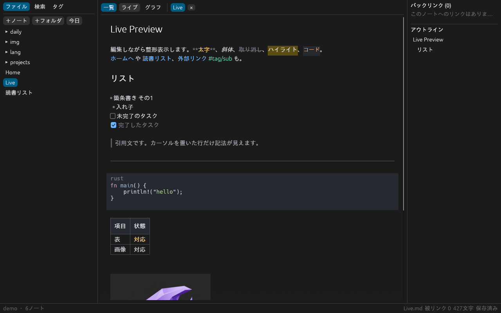

# Robsidian 💎

**Obsidian互換のvaultを、ネイティブRustで速く・軽く・シェルから扱うためのノートアプリ。**

WebViewもNode.jsも使いません。GUIは [egui](https://github.com/emilk/egui) 製の単一バイナリ、
中身はGUIに依存しないRustライブラリで、同じ索引をCLI `rob` からも叩けます。


## なぜ作り直したか

以前の実装は Tauri + TypeScript + CodeMirror で、Rustはファイル入出力だけ（約600行）でした。
実態は「WebViewで動く、機能の少ないObsidian」で、Obsidianを置き換える理由がありませんでした。

そこで方針を変えました。

- **Obsidianを置き換えない。同じvaultで共存する。** ノートはただのMarkdownファイルのまま。
  `[[wikilink]]`・`#tag`・frontmatter（`tags` / `aliases`）・`.obsidian/daily-notes.json` をそのまま読みます。
- **頭脳はすべてRust。** 全ノートをメモリに索引化し、バックリンク・検索・リンク追従リネームをディスクI/Oなしで返します。
- **GUIは薄く、CLIを一級市民に。** Obsidianに無い「シェルやスクリプトからvaultを照会・操作する」手段を持ちます。

## 構成

```text
crates/
  core/   robsidian-core  vault索引・リンク解決・検索・リネーム（GUI非依存、テスト付き）
  cli/    rob             コアをシェルから使うCLI
  app/    robsidian       egui製ネイティブGUI
```

## ビルド

Rust（stable）だけで足ります。Node.js・npm・WebView2は不要です。

```bash
cargo build --release
```

`target/release/robsidian`（GUI）と `target/release/rob`（CLI）ができます。

```bash
cargo run --release -p robsidian -- /path/to/vault
```

日本語はシステムフォント（游ゴシック / ヒラギノ / Noto Sans CJK など）を自動で探して使います。
見つからない環境では `ROBSIDIAN_FONT=/path/to/font.ttf` で指定してください。

## GUI

| 機能 | 内容 |
|---|---|
| Live Preview | 編集しながら整形表示（既定の表示）。カーソルが触れている要素だけ記法が見える。詳細は下記 |
| エディタ | Markdownシンタックスハイライト、`[[` でノート名補完、Ctrl+クリック / Ctrl+Enter でリンクを辿る（無ければ作成） |
| 表示切替 | ライブ / ソース / 分割 / プレビュー。プレビューはコードハイライト・表・タスクリスト・埋め込み画像 `![[img.png]]` |
| クイックスイッチャー | あいまい検索でノートを開く。無い名前ならその場で新規作成 |
| 全文検索 | 空白区切りAND、`"フレーズ"`、`tag:名前`、`path:文字列` |
| バックリンク / アウトライン | 右サイドバーに常時表示、クリックで該当行へ |
| グラフ | ローカル（2ホップ）/ vault全体。ドラッグ・ズーム・クリックで開く |
| 改名 / 移動 | vault内のリンク（wikilink・Markdownリンク）を自動で書き換え |
| 保存 | 自動保存（入力後約1秒・フォーカス喪失時・終了時）、アトミック書き込み |
| 外部変更の追従 | 別エディタやObsidian本体、`git pull` による変更を監視して即反映 |
| 削除 | OSのゴミ箱へ移動（完全削除はしない） |
| 競合の検知 | 編集中に外部（Obsidian本体・同期・別エディタ）でノートが変わったら保存を止め、「外部の変更を読み込む / 自分の編集で上書き / 両方残す / 差分を見る」から選べる |
| ローカル履歴 | 保存で上書きされる直前の内容を `.robsidian/history` に残す（最大50件・30日）。差分を見て任意の版に戻せる |

### Live Preview



「ライブ」表示では、カーソル（選択範囲）が触れている要素だけMarkdown記法をそのまま見せ、それ以外は整形して表示します。
同じ行でも、カーソルを置いた太字の `**` だけが見え、隣のリンクの `[[ ]]` は畳まれたままです。
カーソルが出入りしても行の高さは変わらないので、表示が上下に動きません。

| 要素 | 表示 |
|---|---|
| 見出し・太字・斜体・取り消し線・`==ハイライト==`・インラインコード | 記法を隠して装飾だけ表示 |
| `[[リンク先\|別名]]`・`[文字](URL)` | 別名（文字）だけ表示。Ctrl+クリックで開く |
| 箇条書き・引用・水平線 | 「・」、縦線、横線として描画 |
| タスク `- [ ]` | チェックボックスとして描画。クリックで切り替え |
| コードブロック | 背景付きで表示し、``` を隠す。言語名があれば色分け（Rust・Python・JS・Goなど主要言語） |
| 表 | 罫線付きの表として描画（表の中にカーソルを置くとソースに戻る） |
| 画像だけの行 `![[img.png]]` | その場に画像を表示 |

まだ対応していないもの: ノートの埋め込み（`![[ノート]]`）、コールアウト、数式、Mermaid、
文中の画像。太字は専用フォントが無いため色で表現しています。

### ショートカット

| キー | 動作 |
|---|---|
| Ctrl+P | ノートを開く / 作る |
| Ctrl+Shift+P | コマンドパレット |
| Ctrl+Shift+F | vault全体を検索 |
| Ctrl+N / Ctrl+D | 新規ノート / 今日のデイリーノート |
| Ctrl+E | ライブ → ソース → 分割 → プレビュー |
| Ctrl+G | グラフビュー |
| Ctrl+Enter | カーソル位置のリンクを開く |
| F2 | 現在のノートを改名 / 移動 |
| Ctrl+B / Ctrl+J | 左 / 右サイドバー |
| Ctrl+Tab / Ctrl+W | 次のタブ / タブを閉じる |
| Ctrl+O | 別のvaultを開く |

コマンドパレットは英語でも検索できます（例: `history`、`daily`、`graph`）。
| Ctrl + `+` / `-` | 全体の拡大縮小 |

macOSでは Ctrl の代わりに Cmd です。

## CLI (`rob`)

vaultは `--vault`、環境変数 `ROBSIDIAN_VAULT`、またはカレントから親を辿って
`.obsidian` / `.robsidian` のあるフォルダ、の順で決まります。
出力は1行1件のテキスト（`--json` でJSON）なので、そのままパイプできます。

```bash
rob search rust tag:memo
```

```bash
rob backlinks "Rust メモ"
```

```bash
rob mv "notes/old" "archive/New Name"
```

```bash
rob daily --append "- 14:00 打ち合わせ"
```

| コマンド | 内容 |
|---|---|
| `rob list` | ノート一覧 |
| `rob find <query>` | ノート名のあいまい検索 |
| `rob search <query>` | 全文検索（`path:line:text` 形式、grep互換） |
| `rob cat <note>` | 本文を出力（パスでも名前でも指定可） |
| `rob backlinks <note>` / `rob links <note>` | 被リンク / 発リンク |
| `rob tags [tag]` | タグ一覧 / そのタグを持つノート |
| `rob orphans` / `rob unresolved` | 孤立ノート / リンク切れ |
| `rob new <name> [-c 本文 \| -c -]` | ノート作成（`-` で標準入力） |
| `rob daily [-a テキスト]` | 今日のデイリーノートのパス（追記も可） |
| `rob mv <from> <to>` | 改名 / 移動（リンク追従） |
| `rob graph [-f dot\|json]` | リンクグラフを出力 |
| `rob stats` | 統計 |

## 性能の目安

1万ノート・約40MB（1ノートあたりリンク40本という極端に密なvault）での実測（4コアのLinuxコンテナ）:

| 項目 | 値 |
|---|---|
| CLIの起動〜索引化〜結果出力 | 約0.5秒 |
| GUIのウィンドウ表示まで | 0.1秒台 |
| GUIの常駐メモリ（上記vault / 5ノートのvault） | 約340MB / 約125MB（ソフトウェアGL環境での値） |
| バイナリサイズ | GUI 約14MB、CLI 約3.5MB |

本文とリンク索引をすべてメモリに載せる設計なので、メモリはvaultのサイズとリンク数に比例します。

## 現状の制限

正直なところ、まだ次のものはありません。

- **モーダル編集（Helix / Vim キーバインド）** — エディタはeguiの標準テキスト編集です
- **プラグイン / テーマ機構** — 旧Tauri版にあったJSプラグインAPIは廃止しました（ダーク/ライト切替のみ）
- Mermaid・数式・コールアウトの描画、ペイン分割、内蔵ターミナル
- Live Previewでのチェックボックス切り替えは、Ctrl+Z（元に戻す）の対象になりません
- 動作確認はLinux（X11）のみです。Windows / macOS はCIでビルドとテストを回す設定を入れてありますが、
  実機での確認（特に日本語IME入力）はこれからです

今後の機能追加案と実装方針は [docs/ROADMAP.md](docs/ROADMAP.md) にまとめています。

旧Tauri版のコードはgit履歴に残っています。

## リリース

リリースは自動です。`main` が更新されるたびに GitHub Actions が走り、`Cargo.toml` の
`version` に対応するリリース（`0.2.0` なら `v0.2.0`）がまだ無ければ、3つのOS向けにビルドして
実行ファイル（Windowsは `robsidian.exe` と `rob.exe` 入りのzip）を GitHub Releases に添付します。

新しいバージョンを出すには、ルートの `Cargo.toml` の `version` を上げて `main` にマージするだけです。
同じバージョンのままの更新ではリリースは作られません。

`v` で始まるタグのpushや、Actions画面の「Release」からの手動実行でもリリースできます。

## 開発

```bash
cargo test --workspace
```

```bash
cargo clippy --workspace --all-targets
```
