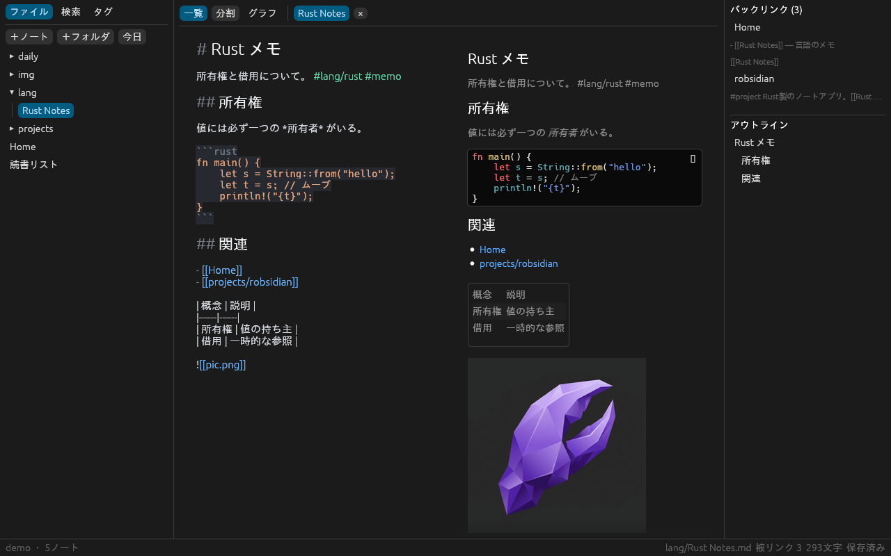

# Robsidian 💎

**Obsidian互換のvaultを、ネイティブRustで速く・軽く・シェルから扱うためのノートアプリ。**

WebViewもNode.jsも使いません。GUIは [egui](https://github.com/emilk/egui) 製の単一バイナリ、
中身はGUIに依存しないRustライブラリで、同じ索引をCLI `rob` からも叩けます。



## なぜ作り直したか

以前の実装は Tauri + TypeScript + CodeMirror で、Rustはファイル入出力だけ（約600行）でした。
実態は「WebViewで動く、機能の少ないObsidian」で、Obsidianを置き換える理由がありませんでした。

そこで方針を変えました。

- **Obsidianを置き換えない。同じvaultで共存する。** ノートはただのMarkdownファイルのまま。
  `[[wikilink]]`・`#tag`・frontmatter（`tags` / `aliases`）・`.obsidian/daily-notes.json` をそのまま読みます。
- **頭脳はすべてRust。** 全ノートをメモリに索引化し、バックリンク・検索・リンク追従リネームをディスクI/Oなしで返します。
- **GUIは薄く、CLIを一級市民に。** Obsidianに無い「シェルやスクリプトからvaultを照会・操作する」手段を持ちます。

## 構成

```text
crates/
  core/   robsidian-core  vault索引・リンク解決・検索・リネーム（GUI非依存、テスト付き）
  cli/    rob             コアをシェルから使うCLI
  app/    robsidian       egui製ネイティブGUI
```

## ビルド

Rust（stable）だけで足ります（Linux は下記の ALSA も）。Node.js・npm・WebView2は不要です。

```bash
cargo build --release
```

Linux では、録音のために ALSA の開発用パッケージが要ります（Debian / Ubuntu なら `sudo apt-get install libasound2-dev`）。

`target/release/robsidian`（GUI）と `target/release/rob`（CLI）ができます。

```bash
cargo run --release -p robsidian -- /path/to/vault
```

日本語はシステムフォント（游ゴシック / ヒラギノ / Noto Sans CJK など）を自動で探して使います。
見つからない環境では `ROBSIDIAN_FONT=/path/to/font.ttf` で指定してください。

## GUI

| 機能 | 内容 |
|---|---|
| Live Preview | 編集しながら整形表示（既定の表示）。カーソルが触れている要素だけ記法が見える。詳細は下記 |
| 編集補助 | Enterでリスト・番号・タスク・引用を継続（空の項目で解除）、Tab / Shift+Tabで字下げ、括弧の自動補完、選択範囲を記号や括弧で囲む、URLを選択範囲に貼るとリンクに、画像を貼ると添付フォルダに保存して埋め込む。どれもCtrl+Zで戻せる |
| エディタ | Markdownシンタックスハイライト、`[[` でノート名補完、`[[ノート#` で見出し補完、Ctrl+クリック / Ctrl+Enter でリンクを辿る（見出しリンクはその見出しへ移動。無ければ作成） |
| 表示モード | ツールバーの選択欄（Ctrl+E で順に切り替え）。ライブ / ソース / ソースとプレビュー / プレビュー。プレビューは Obsidian の既定と同じく、段落の中の改行をそのまま改行として見せる。コードハイライト・表・タスクリスト・埋め込み画像 `![[img.png]]` |
| クイックスイッチャー | あいまい検索でノートを開く。入力前は最近開いた順。無い名前ならその場で新規作成 |
| タスク | 左サイドバーの「タスク」で、vault中の `- [ ] …` を期限切れ・今日・今後・期日なし・完了に分けて一覧し、その場で完了にできる。期日は `📅 2026-01-31`・`due:2026-01-31`・`[due:: 2026-01-31]`。Obsidian の Tasks プラグインと同じく、優先度（`🔺` 最高・`⏫` 高・`🔼` 中・`🔽` 低・`⏬` 最低。一覧に表示し、同じ区分の中は高い順）、完了日（完了にすると `✅ 日付` を付け、戻すと外す）、繰り返し（`🔁 every week` など。完了にすると、日付を進めた次の回を上の行に作る。`every 2 days`・`every month`・`every monday`・`every weekday`・`when done` も可）を読む |
| クエリブロック | ノートに ` ```rob-query ` ブロックを書くと、プレビューで条件に合うノートやタスクの一覧に置き換わる（下記） |
| ペイン分割 | ツールバーの「ペイン分割」で、左右に別のノートを並べる。もう一方のペインをクリックするとそちらに移る。リンクで開いたノートはフォーカスのあるペインに出る。分割の状態は次回も復元 |
| プロパティ | ライブ表示では、frontmatter（YAML）を本文から隠し、上に「プロパティ」欄として表示。値の編集・追加・削除ができる。型（テキスト・リスト・数値・チェックボックス・日付・日付と時刻）に合った入力欄を出す（チェックボックスはクリックで切り替え、日付はカレンダーから選ぶ、数値でない入力は書き込まない）。型は行の先頭の印（文・列・数・真・日・時）をクリックして変え、Obsidian と同じ `.obsidian/types.json` に保存する。指定が無ければ値から推測する。追加するときは vault で使われている名前を候補に出す。変更したキーの行だけを書き換えるので、他の行やコメントは崩れない |
| ノート内の検索・置換 | Ctrl+Fで検索バー、Ctrl+Hで置換。一致をエディタ上で色付けし、Enter / F3で次へ。大文字小文字の区別と正規表現（置換で `$1`）に対応。置換もCtrl+Zで戻せる |
| 設定 | Ctrl+,（またはリボンの下端の歯車。リボンを隠しているときはステータスバーの左端）。テーマ、文字サイズ、読みやすい行幅（本文を一定幅で中央に）、表示モード、日本語フォント、編集補助のオン/オフ、自動保存までの時間、ローカル履歴の件数・日数、コアプラグインに当たる機能のオン/オフ。vaultのテンプレート・デイリーノート・添付の保存先も確認できる |
| ホバープレビュー | リンク先を開かずに覗く。エディタではCtrl（macOSはCmd）を押しながらリンクに乗せる。プレビュー表示ではリンクに乗せるだけ。バックリンク・検索結果・ブックマークは乗せるだけ、ファイル一覧はCtrl+ホバー。見出しリンクはその節だけを表示 |
| 未リンクの言及 | 右サイドバーで、現在のノートの名前（とaliases）がリンクにならずに書かれている箇所を一覧し、1件ずつ、またはまとめて `[[リンク]]` にできる |
| 戻る / 進む | Alt+← / Alt+→、またはマウスの戻る/進むボタン。リンクを辿った経路を行き来できる |
| ブックマーク | ノートの右クリックかコマンドから追加し、左サイドバーの「★」に一覧（`.robsidian/workspace.json`） |
| テンプレート | `templates` フォルダ（Obsidianの設定があればそれ）のノートを、挿入または新規ノートの雛形に使う。`{{title}}`・`{{date}}`・`{{time}}`・`{{date:YYYY年M月D日}}` を展開。デイリーノートにも適用 |
| 全文検索 | 空白区切りAND、`"フレーズ"`、`tag:名前`、`path:文字列` |
| バックリンク / アウトライン | 右サイドバーに常時表示、クリックで該当行へ |
| グラフ | ローカル（2ホップ）/ vault全体。ドラッグ・ズーム・クリックで開く |
| 改名 / 移動 | vault内のリンク（wikilink・Markdownリンク）を自動で書き換え |
| 保存 | 自動保存（入力後約1秒・フォーカス喪失時・終了時）、アトミック書き込み |
| 外部変更の追従 | 別エディタやObsidian本体、`git pull` による変更を監視して即反映 |
| 削除 | OSのゴミ箱へ移動（完全削除はしない） |
| 競合の検知 | 編集中に外部（Obsidian本体・同期・別エディタ）でノートが変わったら保存を止め、「外部の変更を読み込む / 自分の編集で上書き / 両方残す / 差分を見る」から選べる |
| ローカル履歴 | 保存で上書きされる直前の内容を `.robsidian/history` に残す（最大50件・30日）。差分を見て任意の版に戻せる |

### Live Preview


「ライブ」表示では、カーソル（選択範囲）が触れている要素だけMarkdown記法をそのまま見せ、それ以外は整形して表示します。
同じ行でも、カーソルを置いた太字の `**` だけが見え、隣のリンクの `[[ ]]` は畳まれたままです。
カーソルが出入りしても行の高さは変わらないので、表示が上下に動きません。

| 要素 | 表示 |
|---|---|
| 見出し・太字・斜体・取り消し線・`==ハイライト==`・インラインコード | 記法を隠して装飾だけ表示 |
| `[[リンク先\|別名]]`・`[文字](URL)` | 別名（文字）だけ表示。Ctrl+クリックで開く |
| 箇条書き・引用・水平線 | 「・」、縦線、横線として描画 |
| タスク `- [ ]` | チェックボックスとして描画。番号付き（`1. [ ]`）・引用やコールアウトの中も同じ。`[/]`（進行中）は半分塗り、`[-]`（取り消し）は横線、そのほかの文字（`[>]` など）はその文字を表示。クリックで、未完了なら完了に、それ以外は未完了に戻す |
| コードブロック | 背景付きで表示し、``` を隠す。言語名があれば色分け（Rust・Python・JS・Goなど主要言語） |
| 表 | 罫線付きの表として描画（表の中にカーソルを置くとソースに戻る） |
| 画像だけの行 `![[img.png]]` | その場に画像を表示 |
| ノートだけの行 `![[ノート]]` / `![[ノート#見出し]]` | そのノート（または節）の内容を枠付きで表示。中のリンクはクリックで開ける |
| コールアウト `> [!tip] タイトル` | 種類ごとの色の枠で表示（note / tip / warning / danger / example など、Obsidianの種類）。タイトルが無ければ種類名を出す |
| 太字・見出し | 太字のフォントで描く（游ゴシック Bold・ヒラギノ W6・Noto Sans CJK Bold などを自動で探す。無ければ英字だけ太字になり、日本語は色で表す） |

プレビュー表示でも、ノートの埋め込みは引用ブロックとして展開し、コールアウトは同じ種類で描きます。

- **文中の画像**：`文章 ![[pic.png]] 文章` のように行の途中にある画像も、その場に表示します（高さは200pxまで）。
- **コールアウトの折りたたみ**：`> [!tip]-` は閉じた状態、`> [!tip]+` は開いた状態で表示します。
  タイトルの右の三角で開閉できます。開閉は表示だけで、ファイルは書き換えません。

### 数式とMermaid

- **数式**：`$…$`（行内）と `$$…$$`（表示数式）を、ライブ表示とプレビューの両方で組んで表示します。
  - 対応しているもの
    - 分数・根号・上付き/下付き・総和や積分の上下の添字
    - ギリシャ文字・演算子・矢印
    - `\left( … \right)` の伸びる括弧
    - `pmatrix` / `bmatrix` / `cases` / `aligned`
    - `\text` / `\mathbb` / アクセント（`\hat` `\vec` `\bar` …）
  - 知らない命令は `\命令` のまま表示します。
  - ライブ表示では、カーソルが数式に入るとTeXが見えます。行の高さは変わりません。
  - `$5 と $10` のような金額は、数式として扱いません。
  - TeXのよく使う部分を自前で組んでいるので、KaTeX / MathJax と同じ見た目にはなりません。
- **Mermaid**：` ```mermaid ` のブロックは、[mermaid-cli](https://github.com/mermaid-js/mermaid-cli)（`mmdc`）が入っていれば、プレビューで図として表示します。
  - 図は `.robsidian/cache/mermaid` にキャッシュし、同じ図は作り直しません。
  - コマンドは設定（Ctrl+,）の「Mermaid図のコマンド」で変えられ、空にすると使いません。
  - ライブ表示ではコードのままです。
- `rob export` のHTMLでは、数式を1行の文字（`x²`、`(a+b)/c` など）に直して書き出します。

### Vimキーバインド（モーダル編集）

設定（Ctrl+,）またはコマンド「Vimキーバインドの切り替え」で有効にします（既定は無効）。
ステータスバーにモード（`-- NORMAL --` など）と入力途中のキーが表示されます。
ノーマルモード中はIMEを止めるので、日本語入力をオンにしたままでもキーがコマンドとして届きます（全角英数字も半角として扱います）。

| 種類 | 対応しているもの |
|---|---|
| 移動 | `h j k l` `w b e` `W B E` `0 ^ $` `gg G` `{n}G` `f F t T ; ,` `{ }` `%` Ctrl+D / Ctrl+U、数値の前置（`3w`） |
| 挿入 | `i a I A o O s S C` |
| 演算子 | `d c y > < gu gU g~` ＋ 移動 / テキストオブジェクト（`iw aw iW aW ip ap i( a( i[ i{ i< i" i'` と、バッククォートの内側）、`dd cc yy >> <<` |
| 編集 | `x X D Y r~ J p P`、`.`（繰り返し）、`u` / Ctrl+R（元に戻す / やり直し） |
| ビジュアル | `v` `V`、選択中に `d c y > < u U ~ o` |
| 検索 | `/` `?`（検索バー）、`n N`、`* #`（カーソル下の語） |
| コマンド | `:w` `:q` `:wq` `:x` `:{行番号}` `:noh` |

日本語の単語は文字の種類（ひらがな・カタカナ・漢字）の変わり目で区切ります。ヤンクした文字列はシステムのクリップボードにも入ります。
ノーマルモードでは Ctrl+D はデイリーノートではなく半画面移動になります。

### Helix風のキー操作

設定（Ctrl+,）の「キー操作」で「Helix」を選びます。Helix と同じく、まず選んでから操作します。
ステータスバーにモード（`NORMAL` / `SELECT` / `INSERT`）が表示されます。

| 種類 | 対応しているもの |
|---|---|
| 選ぶ | `w b e` `W B E`（単語）、`x`（行。押すたびに次の行まで広げる）、`%`（全体）、`f t F T`（文字まで）、数値の前置 |
| 動く | `h j k l`、`gg ge gh gl gs`、Ctrl+D / Ctrl+U |
| 選択に対して | `d`（削除）、`c`（削除して挿入）、`y`（コピー）、`p P`（後ろ / 前に貼り付け）、`r`（1文字で置き換え）、`~`（大小反転）、`` ` ``（小文字に）、`> <`（字下げ）、`J`（行をつなぐ） |
| 選択の操作 | `v`（選択を広げるモード）、`;`（選択を畳む）、Esc |
| 挿入 | `i a`（選択の前 / 後ろ）、`I A o O` |
| その他 | `u U`（元に戻す / やり直し）、`/ ? n N *`（検索）、`:w` `:q` など |

マルチカーソル、`s`（選択内の正規表現）、テキストオブジェクト（`mi` など）は未対応です。

### 検索条件とクエリブロック

全文検索（Ctrl+Shift+F）、` ```rob-query ` ブロック、`rob query` / `rob tasks` は同じ書き方です。条件は空白区切りのANDです。

| 条件 | 意味 |
|---|---|
| `語`・`"フレーズ"` | 本文（タスクの条件があるときはタスクの本文）に含む |
| `tag:名前` / `path:文字列` | タグ（子タグも含む）/ パスで絞る |
| `task:todo` / `task:done` / `task:any` | タスクを探す（未完了 / 完了 / すべて） |
| `due:overdue` / `due:today` / `due:week` / `due:none` / `due:any` | 期日で絞る（`due:<2026-02-01`・`due:>=2026-01-01`・`due:2026-01-31` も可）。`due:` があればタスクを探す |
| `priority:high` など | 優先度で絞る（`highest` `high` `medium` `low` `lowest` `none`）。あればタスクを探す |
| `sort:score` / `name` / `path` / `mtime` / `due` / `priority` | 並び順（既定はノートなら関連度、タスクなら期日。`priority` は優先度の高い順） |
| `[キー:値]` / `[キー]` | frontmatterのプロパティで絞る（値は部分一致。リストはどれかの項目に一致） |
| `limit:件数` | 件数の上限 |

````markdown
```rob-query
task:todo due:week tag:work
```
````

プレビュー表示では、結果のリスト（ノートへのリンク、またはタスクと期日）に置き換わります。
プレビューのチェックボックスはクリックで切り替えられ、元のノートに反映されます（Ctrl+Zで戻せます）。

### ユーザーコマンド（シェルコマンドで拡張する）

プラグインの代わりに、`.robsidian/commands.toml` に書いたシェルコマンドを
コマンドパレットやショートカットから実行できます。言語は問いません。

```toml
[[command]]
name = "選択範囲を大文字に"
run = "tr a-z A-Z"
input = "selection"   # none（既定） / selection / note
output = "replace"    # notice（既定） / replace / insert / none
key = "ctrl+alt+u"    # 省略可。macOSでは ctrl が Cmd になる

[[command]]
name = "今日の日付を挿入"
run = "date +%Y-%m-%d"
output = "insert"
```

- `input` の内容を標準入力に渡し、標準出力を `output` に従って使います。
  `replace` は選択範囲（`input = "note"` ならノート全体）を置き換え、`insert` はカーソル位置に挿入します。
  どちらも Ctrl+Z で戻せます。
- vaultのフォルダで `sh -c`（Windowsは `cmd /C`）として実行します。環境変数は次のとおりです。
  - `ROB_VAULT`：vaultのパス
  - `ROB_FILE`：現在のノートのフルパス
  - `ROB_NOTE`：vault内でのパス
  - `ROB_LINE`：カーソルの行
- 実行の前に、編集中のノートを保存します。実行中にノートを編集した場合、結果は反映しません。
- **他人のvaultを開いただけでコマンドが動かないよう**、初めて実行するときにファイルの中身を見せて許可を求めます。
  許可はvaultの外（アプリの設定）に記録します。ファイルが書き換わったら、もう一度確認します。
- `rob run <名前>` でシェルからも実行できます（標準入力が入力になります）。

### プラグイン（自分で作る）

`.robsidian/plugins/<id>/plugin.toml` を置くと、プラグインとして読み込みます（`<id>` はフォルダ名。英数字・`-`・`_`）。
プラグインはどの言語でも書けます。呼ぶたびに `run` のコマンドを起動し、標準入力に JSON を1つ渡して、標準出力から JSON を1つ受け取ります。
プラグインは中身（Markdown や「してほしいこと」）を返すだけで、描くのとファイルを書き換えるのは Robsidian が行います
（書き換えにもローカル履歴が効き、Ctrl+Z で戻せます）。例は [`examples/plugins/`](examples/plugins/) にあります。

```toml
name = "サンプル"
version = "0.1.0"
description = "説明"
run = "python3 main.py"     # プラグインのフォルダで sh -c（Windows は cmd /C）として実行する

[[command]]                 # コマンドパレットとショートカットに出る
id = "upper"
name = "選択範囲を大文字に"
input = "selection"         # none / selection / note（リクエストに入れるもの）
key = "ctrl+alt+u"

[[codeblock]]               # ```csv のブロックを、プラグインが返した Markdown で描く（プレビュー）
lang = "csv"

[[panel]]                   # 右サイドバーの欄（ノートを開いたとき・保存したときに作り直す）
id = "stats"
title = "ノートの統計"

[[event]]                   # save（保存したとき）/ open（開いたとき）
on = "save"
```

標準入力に渡すリクエスト:

```json
{"api": 1, "kind": "command", "id": "upper", "vault": "/path/to/vault",
 "note": {"path": "a.md", "text": "本文（note・event・panel のとき）", "selection": "選択範囲", "line": 3},
 "code": "コードブロックの中身（codeblock のとき）"}
```

標準出力に返すレスポンス（JSON でなければ、出力そのものを通知、またはコードブロック・パネルの Markdown として扱います）:

```json
{"markdown": "コードブロック・パネルの中身",
 "actions": [
   {"type": "notice", "text": "通知"},
   {"type": "replace_selection", "text": "選択範囲を置き換える（コマンドだけ）"},
   {"type": "insert", "text": "カーソル位置に挿入する（コマンドだけ）"},
   {"type": "replace_note", "text": "開いているノートの本文を置き換える"},
   {"type": "open", "path": "ノートを開く"},
   {"type": "write_note", "path": "b.md", "text": "ほかのノートを書く・作る"}]}
```

- **許可**：初めて使うときと `plugin.toml` が変わったときに、中身を見せて許可を求めます（設定の「プラグイン」でも許可・取り消し・オン/オフができます）。
  プラグインはあなたの権限でコマンドを実行するので、他人の vault のプラグインは、フォルダの中身を確かめてから許可してください
- 実行は別スレッドで行い、30秒で打ち切ります。頼んだあとにノートを編集していたら、置き換えは反映しません
- プラグインが書き換えた内容を保存したときは、保存のイベントをもう一度は呼びません（無限に続かないように）
- 環境変数 `ROB_VAULT` `ROB_NOTE` `ROB_PLUGIN_DIR` も渡します
- 画面なしで試すには `rob plugin list` と `rob plugin run <id> <command|codeblock|panel|event> <名前> [--note ノート] [--text 中身]`
- 設計は [docs/ROADMAP.md](docs/ROADMAP.md) のフェーズE

#### 常駐するプラグイン（`mode = "server"`）

`plugin.toml` に `mode = "server"` と書くと、最初に使うときに起動し、そのまま起動しておきます。毎回起動しないので速く、状態も持てます。
やりとりは行区切りの JSON-RPC 2.0 で、依頼（`plugin/request`）の中身は上と同じです。加えて、プラグインから Robsidian に問い合わせられます。

| 問い合わせ | 返事 |
|---|---|
| `vault/read` `{path}` | `{path, text}`（開いているノートは保存前の内容） |
| `vault/list` `{folder?}` | ノートのパスの一覧 |
| `vault/search` `{query, limit?}` | 検索条件（`rob query` と同じ書き方）に合うノートかタスク |
| `vault/backlinks` `{path}` | このノートへのリンクの一覧 `[{source, line}]` |
| `vault/write` `{path, text}` | ノートを書く・作る（開いていればタブに反映。Ctrl+Z で戻せる） |

通知（返事なし）は `ui/notice` `{text}` と `panel/refresh` `{id?}`（パネルを作り直させる）です。
プラグインは、標準入力が閉じたら終わるようにしてください（アプリを終了したときに残らないように）。
Python なら [`examples/plugins/weekly/robsidian.py`](examples/plugins/weekly/robsidian.py) を写すと、関数を1つ書くだけで作れます。

#### WASM のプラグイン（`mode = "wasm"`）

人に配る・人から受け取るプラグインは、WASM で作ると安全です。WASM のプラグインは箱（サンドボックス）の中で動き、
ファイル・ネットワーク・プロセスには直接触れません。Robsidian への問い合わせ（上の表）も、`permissions` で許した分だけ通します。

```toml
name = "見出しとつながり"
mode = "wasm"
wasm = "plugin.wasm"         # 省くと plugin.wasm
permissions = ["read"]       # read: vault/read・list・search・backlinks、write: vault/write。書かなければ問い合わせできない
```

- 依頼と返事の形は、ほかのプラグインと同じ JSON です。WASM との約束（`alloc`・`handle` と、取り込み関数 `robsidian.call`・`notify`・`log`）は
  [docs/ROADMAP.md](docs/ROADMAP.md) のフェーズE3 にあります
- Rust で書く例と、そのまま写せる助けの関数は [`examples/plugins/wasm-headings/`](examples/plugins/wasm-headings/)
- 計算が長すぎるもの（止まらないもの）は止め、次に使うときに読み込み直します。メモリは 256MB まで
- `.wasm` の中身が変わると、もう一度許可を求めます（許可の記録に `.wasm` の sha256 を含めます）

#### プラグインを探して入れる

プラグインの一覧（`catalog.json`）の URL を、設定の「プラグイン」→「プラグインを探す」に入れると、検索して「入れる」で入れられます。
CLI では `rob plugin search [語] --catalog <URL>` と `rob plugin install <id> --catalog <URL>`（`ROB_PLUGIN_CATALOG` でも指定できます）。

- ファイルは `curl` で取ってきて、一覧に書かれた sha256 と一致したときだけ入れます（`file://` やファイルのパスも使えます）
- 入れても許可はしません。使う前に、中身を見て許可してください
- 一覧の書き方と作り方は [`examples/catalog/`](examples/catalog/)。公式の一覧はまだありません

### Obsidian のコアプラグインに相当する機能

画面の左端の「リボン」に、有効なコアプラグインのアイコンが並びます（マウスを乗せると名前が出ます）。
上から、クイックスイッチャー・グラフビュー・新しいキャンバス・デイリーノート・テンプレートの挿入・コマンドパレット・
ランダムノート・新しいベース・スライド・ユニークノート・音声録音（録音中は赤）・ワークスペース（保存 / 開く / 削除のメニュー）で、
下端は設定の歯車です。新しいキャンバスとベースは、開いているノートと同じフォルダに「無題のキャンバス」「無題のベース」として作ります。
リボンは設定の「外観」で隠せます。

設定（Ctrl+,）の「コアプラグイン」で、下の表の機能（Obsidian のコアプラグインに当たるもの）を1つずつオン/オフできます（既定はすべてオン）。
- オフにした機能は、コマンドパレット・ショートカット・サイドバー・ツールバー・ステータスバー・右クリックのメニューから消えます。
  左右のサイドバーは、出すものが無くなったタブや欄を隠します。
- Bases・Canvas・音声録音をオフにすると、`.base` `.canvas` WAV は、ほかのファイルと同じく既定のアプリで開きます。
- ファイル復元をオフにすると、ローカル履歴を残しません。プロパティをオフにすると、frontmatter を YAML のまま見せます。
- フォーマット変換・Publish・Sync・Web ビューアは Robsidian にありません（下記）。

| Obsidian のコアプラグイン | Robsidian |
|---|---|
| バックリンク・発リンク・アウトライン | 右サイドバー。発リンクは、まだ無いノートを薄く表示し、クリックで作る |
| 脚注ビュー | 右サイドバーの「脚注」。ノートに脚注があるときだけ出し、クリックで定義の行へ移動する |
| 文字数カウント | ステータスバーに文字数（空白を除く）と単語数。選択しているときは選択範囲の数も出す。単語数は、欧文は語、日本語などは1文字を1語と数える（Obsidian と同じ） |
| ランダムノート | コマンド「ランダムなノートを開く」 |
| ユニークノート作成 | コマンド「ユニークノートを作成」。`202611181230` のような年月日時分の名前で、開いているノートと同じフォルダに作る |
| スラッシュコマンド | 行頭か空白の直後で `/` を入力すると、コマンドパレットが開く。選んだら `/` を消して実行し、Esc なら `/` を残す |
| ノートコンポーザー | 「選択範囲（または見出しの節）を新しいノートに切り出す」：名前を確かめて同じフォルダに作り、元の場所はリンクにする（Ctrl+Zで戻せる）。「このノートを別のノートに結合」：結合先の末尾に足し、このノートへのリンクを結合先に付け替え、このノートはゴミ箱へ |
| ワークスペース | 開いているタブと分割の配置を名前を付けて保存し、コマンドパレットから開く・削除する（`.robsidian/workspace.json`） |
| Bases | `.base` ファイルを開くと、プロパティの表を出す（ビューの切り替え、名前のクリックでノートを開く）。ノートの中の ` ```base ` ブロックと `![[ファイル.base#ビュー]]` は、プレビューで表にする。書き方は下記 |
| スライド | コマンド「スライドとして表示」で、ノートを `---` だけの行で区切って全画面で表示する。→ / Space で次、← で前、Esc で終わる |
| Canvas | `.canvas` ファイル（JSON Canvas）を開くと、カードと矢印を表示して編集できる。空いた所のドラッグで移動、ホイールで拡大縮小。カードはクリックで選んでドラッグで動かし、右下の角で大きさを変え、選んだカードの丸からドラッグで別のカードにつなぐ。ダブルクリックで、テキストは書き換え・ノートは開く・空いた所ならカードを作る。右クリックで色・矢印・削除。Ctrl+Z / Ctrl+Shift+Z で元に戻す / やり直す |
| 音声録音 | コマンド「録音を開始 / 停止」。録音中はステータスバーに「● 録音中」が出て、クリックで止まる。止めると添付の場所に `Recording 年月日時分秒.wav` を保存し、ノートに埋め込む。埋め込んだ WAV は、ライブ表示の再生ボタンやプレビューの「▶」リンクで、その場で再生できる（もう一度クリックで止まる） |
| ブックマーク・コマンドパレット・デイリーノート・ファイル一覧・グラフ・検索・タグ・テンプレート・クイックスイッチャー・ページプレビュー・プロパティ・ファイル復元 | それぞれ実装済み（上の各節） |

後回しにしたものと作らないものは [docs/ROADMAP.md](docs/ROADMAP.md) のフェーズDにまとめています。

#### Bases の書き方

Obsidian の `.base` のうち、よく使う部分に対応しています（Obsidian の仕様との突き合わせはまだで、互換は一部です）。

```yaml
filters:            # すべてのビューに効く条件。and / or / not を入れ子にできる
  and:
    - file.hasTag("book")
    - 'status != "読了"'
formulas:           # 計算列。列や並べ替えでは formula.名前 と書く
  星: 'if(rating, "★".repeat(rating), "未評価")'
  経過年: 'if(published, today().year - published.year + "年前", "")'
properties:
  author:
    displayName: 著者
  formula.星:
    displayName: 評価
views:
  - type: table
    name: 読書中
    order: [file.name, author, status, formula.星]   # 列
    sort:
      - property: rating
        direction: DESC
    limit: 20
    filters: 'rating >= 4'               # このビューだけの条件
  - type: cards                          # カード
    name: 表紙
    image: note.cover                    # 画像にするプロパティ（[[表紙.png]]・ファイル名・URL）
    cardSize: 200                        # カードの幅
    imageAspectRatio: 1.4                # 画像の高さ / 幅
    imageFit: contain                    # 全体を収める（既定は枠いっぱいに切り抜く）
  - type: table
    name: 状態ごと
    groupBy:                             # グループ分け
      property: note.status
      direction: ASC
    summaries:                           # 集計（グループごと。グループ分けしなければ全体）
      rating: Average
      author: Unique
```

- 式（条件と計算列で同じ）
  - 演算子：`+ - * / %`、比較（`==` `!=` `>` `<` `>=` `<=`）、`&&` `||` `!`、`条件 ? A : B`、かっこ、リスト `[a, b]`
  - 参照：frontmatter のキー（`note.x`、空白などを含む名前は `note["x y"]`）、`file.name` `file.basename` `file.path` `file.folder` `file.ext` `file.size` `file.mtime` `file.ctime` `file.tags` `file.links` `file.backlinks`、`formula.x`
  - ファイル：`file.hasTag()` `file.inFolder()` `file.hasLink()` `file.hasProperty()`
  - 関数：`if()` `now()` `today()` `date()` `number()` `string()` `list()` `link()` `max()` `min()` `duration()`
  - 文字列：`.length` `contains()` `containsAny()` `containsAll()` `startsWith()` `endsWith()` `lower()` `upper()` `title()` `trim()` `replace()` `repeat()` `slice()` `split()`
  - 数値：`toFixed()` `round()` `abs()` `ceil()` `floor()`
  - リスト：`.length` `[番号]` `contains()` `containsAny()` `containsAll()` `join()` `reverse()` `sort()` `unique()` `flat()` `slice()`
  - 日付：`.year` `.month` `.day` `.hour` `.minute` `format("YYYY-MM-DD")` `date()` `time()` `relative()`、期間の足し引き（`now() - "7d"`、単位は `y` `M` `w` `d` `h` `m` `s`）、日付どうしの差（ミリ秒）
  - どの値にも：`isEmpty()` `toString()`
- 集計の種類：`Sum` `Average` `Min` `Max` `Median` `Range` `Stddev` `Earliest` `Latest` `Checked` `Unchecked` `Empty` `Filled` `Unique` `Count`
- 未対応：`this`、ラムダ式（`map` / `filter`）。未対応のものは、黙って無視せずエラーとして表示します
- カードのビューは、ノートの中の埋め込みやプレビューでは、画像を先頭の列にした表として出します

### 関連ノート

右サイドバーの「関連ノート」に、直接はリンクしていないが関係の深いノートが出ます。
- 共通のリンク先・リンク元（同じノートからリンクされている、同じノートにリンクしている）と、共通のタグの重なり（Jaccard係数）で順位を付けます。
- 各ノートの下に「共通のつながり」「共通のタグ」を表示し、なぜ関係があるのかがわかるようにしています。
- 本文の意味までは見ません。
- シェルからは `rob related <ノート>` で同じ結果を得られます。

### テーマ設定ファイル

`.robsidian/theme.toml` で配色を上書きできます。ダークとライトで別々に指定し、書いた色だけが変わります。
ファイルを保存するとすぐ反映され、消せば元の色に戻ります。

```toml
[dark]
background = "#1a1b26"   # パネルとウィンドウの背景
input_bg   = "#16161e"   # 入力欄の背景
selection  = "#33467c"   # 選択範囲・選択中のボタン
text       = "#c0caf5"
heading    = "#bb9af7"
accent     = "#7aa2f7"   # リンク（link で別に指定も可）
tag        = "#9ece6a"

[light]
accent = "#2a5bd7"
```

色は `#rgb` / `#rrggbb` / `#rrggbbaa` で書きます。指定できるキーは次のとおりです。
- エディタ：`text` `dim` `heading` `accent` `tag` `strong` `code` `code_bg` `quote` `mark_bg` `diff_add` `diff_del` `find_bg` `find_current` `warn_bg`
- 画面全体：`background` `input_bg` `selection` `ui_text` `link`

知らないキーや色の誤りは通知で知らせます。フォントは設定画面（Ctrl+,）で変えます。
CSSではないので、Obsidianのテーマはそのままでは使えません。

### git連携

vaultがgitのリポジトリの中にあると、ステータスバーにコミットされていない変更の件数が出ます。
- **スナップショットをコミット**：件数をクリックするか、コマンド「gitにスナップショットをコミット」で、vault以下の変更をまとめてコミットします。
  コミットするのはvault以下だけで、vaultがリポジトリのサブフォルダでも、外のファイルは巻き込みません。
  ローカル履歴（`.robsidian/history`）と作業状態（`.robsidian/workspace.json`）は対象から外します。
- **履歴画面**：ローカル履歴の版と並べて、そのノートを変更したコミットが時刻順に出ます（改名も追いかけます）。
  差分を見て、その版に戻せます。
- **取り込み・送信**：ステータスバーの `↑2 ↓1`（リモートより進んでいる / 遅れているコミット数）をクリックするか、
  コマンド「gitでリモートへ送る（push）」「gitでリモートの変更を取り込む（pull）」で同期します。
  - 取り込みは `git pull --rebase --autostash` です。
  - **競合したときは取り込みを取り消し、手元の状態を元のまま残します**。競合は、シェルで解決してください。
  - 送るときにリモートが先に進んでいたら、先に取り込むよう知らせます。
  - ↓ の数は、最後に取り込んだ時点の値です（自動では fetch しません）。
- `git` コマンドを呼び出して動きます。シェルからは `rob snapshot [-m メッセージ]` / `rob pull` / `rob push` でも操作できます。

### ショートカット

| キー | 動作 |
|---|---|
| Ctrl+P | ノートを開く / 作る |
| Ctrl+Shift+P | コマンドパレット |
| Ctrl+Shift+F | vault全体を検索 |
| Ctrl+N / Ctrl+D | 新規ノート / 今日のデイリーノート |
| Ctrl+E | ライブ → ソース → 分割 → プレビュー |
| Ctrl+G | グラフビュー |
| Ctrl+Enter | カーソル位置のリンクを開く |
| F2 | 現在のノートを改名 / 移動 |
| Ctrl+B / Ctrl+I | 太字 / 斜体（もう一度押すと解除） |
| Ctrl+L | チェックボックスを付ける / 切り替える |
| Tab / Shift+Tab | リストや選択した行の字下げ / 字上げ |
| Ctrl+\\ / Ctrl+J | 左 / 右サイドバー |
| Ctrl+Tab / Ctrl+W | 次のタブ / タブを閉じる |
| Ctrl+F / Ctrl+H | ノート内の検索 / 置換 |
| F3 / Shift+F3 | 次 / 前の一致 |
| Ctrl+, | 設定 |
| Alt+← / Alt+→ | 戻る / 進む |
| Ctrl+O | 別のvaultを開く |
| Ctrl + `+` / `-` | 全体の拡大縮小 |

コマンドパレットは英語でも検索できます（例: `history`、`daily`、`graph`）。

macOSでは Ctrl の代わりに Cmd です。

## CLI (`rob`)

vaultは `--vault`、環境変数 `ROBSIDIAN_VAULT`、またはカレントから親を辿って
`.obsidian` / `.robsidian` のあるフォルダ、の順で決まります。
出力は1行1件のテキスト（`--json` でJSON）なので、そのままパイプできます。

```bash
rob search rust tag:memo
```

```bash
rob backlinks "Rust メモ"
```

```bash
rob mv "notes/old" "archive/New Name"
```

```bash
rob daily --append "- 14:00 打ち合わせ"
```

| コマンド | 内容 |
|---|---|
| `rob list` | ノート一覧 |
| `rob find <query>` | ノート名のあいまい検索 |
| `rob search <query>` | 全文検索（`path:line:text` 形式、grep互換） |
| `rob cat <note>` | 本文を出力（パスでも名前でも指定可） |
| `rob backlinks <note>` / `rob links <note>` | 被リンク / 発リンク |
| `rob related <note> [-n 件数]` | 関連ノート（`スコア\tパス`） |
| `rob mentions <note> [--link]` | 未リンクの言及（`--link` ですべてリンクに書き換える） |
| `rob tags [tag]` | タグ一覧 / そのタグを持つノート |
| `rob tasks [条件] [--all \| --done]` | タスクの一覧（`path:行: [ ] 本文  📅 期日`。優先度・繰り返し・完了日も） |
| `rob query <条件>` | 条件に合うノートやタスク（クエリブロックと同じ書き方） |
| `rob plugin list` / `rob plugin run …` | プラグインの一覧と、画面なしでの実行（プラグインを作るときの確かめに） |
| `rob plugin search` / `rob plugin install` | プラグインの一覧（catalog.json）から探す・入れる |
| `rob orphans` / `rob unresolved` | 孤立ノート / リンク切れ |
| `rob new <name> [-c 本文 \| -c -] [-t テンプレート]` | ノート作成（`-` で標準入力、`-t` でテンプレートを展開） |
| `rob templates` | テンプレートの一覧 |
| `rob daily [-a テキスト]` | 今日のデイリーノートのパス（追記も可） |
| `rob mv <from> <to>` | 改名 / 移動（リンク追従） |
| `rob graph [-f dot\|json]` | リンクグラフを出力 |
| `rob stats` | 統計 |
| `rob lint [--orphans] [--strict]` | リンク切れ・埋め込み先なし（エラー）、曖昧なリンク・孤立ノート（警告）を `path:行: level[code]: 内容` で報告。エラーがあれば終了コード1（`--strict` で警告も） |
| `rob export <出力先> [--force]` | vaultを静的HTMLサイトに書き出す（リンクは相対パス、見出しへのアンカー、被リンク一覧付き） |
| `rob tag-rename <旧> <新>` | タグの一括改名（本文の `#タグ`・子タグ・frontmatterの `tags`） |
| `rob serve` | 標準入出力で1行1リクエストのJSONに答える常駐モード（下記） |
| `rob run [名前] [-n ノート]` | ユーザーコマンドの実行（名前を省くと一覧）。標準入力が入力、標準出力がそのまま出る |
| `rob snapshot [-m メッセージ]` | vault以下の変更をgitにコミット |
| `rob pull` / `rob push` | リモートの変更を取り込む（競合したら取り消す）/ リモートへ送る |
| `rob mcp` | MCPサーバーとして動く（下記） |
| `rob base <ファイル> [--view 名前]` | Bases の表を出力（タブ区切り、`--json` でJSON） |

`rob lint` はノートのリポジトリのCIにそのまま組み込めます。

```bash
rob lint --orphans --strict
```

`rob serve` は `{"id":1,"method":"search","params":{"query":"rust"}}` のような1行を受け取り、
`{"id":1,"result":...}`（失敗時は `{"id":1,"error":"..."}`）を1行で返します。
索引を持ち続け、リクエストのたびに変更のあったファイルだけ読み直します。
メソッドは `stats` `list` `find` `search` `query` `tasks` `cat` `backlinks` `links` `resolve` `mentions` `related` `write` `daily` です。

### MCPサーバー（AIアシスタントから使う）

`rob mcp` は vault を [MCP](https://modelcontextprotocol.io/) サーバーとして公開します。
Claude Desktop や Claude Code などのAIアシスタントから、ノートを検索したり読み書きしたりできます。

```bash
claude mcp add robsidian -- rob mcp --vault /path/to/vault
```

Claude Desktop などでは、設定ファイルに次のように書きます。

```json
{ "mcpServers": { "robsidian": { "command": "rob", "args": ["mcp", "--vault", "/path/to/vault"] } } }
```

- 読むツール：`search` `find_notes` `list_notes` `read_note` `backlinks` `outgoing_links` `related_notes` `query` `tasks`
- 書くツール：`write_note` `append_to_note` `daily_note`
  - 書けるのは vault 内の `.md` だけで、上書きの直前の内容はローカル履歴に残ります。
- 呼び出しのたびに、他のアプリで変わったファイルを読み直します。

## 性能の目安

1万ノート・約40MB（1ノートあたりリンク40本という極端に密なvault）での実測（4コアのLinuxコンテナ）:

| 項目 | 値 |
|---|---|
| CLIの起動〜索引化〜結果出力 | 約0.4秒 |
| 保存時の索引の更新（1ノート） | 1〜2ミリ秒（別名が変わったときだけ全体を作り直す） |
| GUIのウィンドウ表示まで | 0.1秒台 |
| GUIの常駐メモリ（上記vault / 5ノートのvault） | 約340MB / 約125MB（ソフトウェアGL環境での値） |
| バイナリサイズ | GUI 約14MB、CLI 約3.5MB |

本文とリンク索引をすべてメモリに載せる設計なので、メモリはvaultのサイズとリンク数に比例します。

## 現状の制限

正直なところ、まだ次のものはありません。

- **プラグイン / テーマ機構** — 旧Tauri版にあったJSプラグインAPIは廃止しました。拡張はユーザーコマンド（シェルコマンド）で、配色はテーマ設定ファイルで変えます
- 内蔵ターミナル。Mermaidの図は外部コマンド（mmdc）が無いと表示できません
- 動作確認はLinux（X11）のみです。Windows / macOS はCIでビルドとテストを回す設定を入れてありますが、
  実機での確認（特に日本語IME入力）はこれからです

今後の機能追加案と実装方針は [docs/ROADMAP.md](docs/ROADMAP.md) にまとめています。

旧Tauri版のコードはgit履歴に残っています。

## リリース

リリースは自動です。`main` が更新されるたびに GitHub Actions が走り、`Cargo.toml` の
`version` に対応するリリース（`0.2.0` なら `v0.2.0`）がまだ無ければ、3つのOS向けにビルドして
実行ファイル（Windowsは `robsidian.exe` と `rob.exe` 入りのzip）を GitHub Releases に添付します。

新しいバージョンを出すには、ルートの `Cargo.toml` の `version` を上げて `main` にマージするだけです。
同じバージョンのままの更新ではリリースは作られません。

`v` で始まるタグのpushや、Actions画面の「Release」からの手動実行でもリリースできます。

## 開発

```bash
cargo test --workspace
```

```bash
cargo clippy --workspace --all-targets
```

重さを調べるときは、環境変数 `ROBSIDIAN_PROFILE=1` を付けて起動すると、8ms を超えた描画の内訳（エディタの組み立て・装飾・サイドバーなど）を標準エラーに出します。`ROBSIDIAN_PROFILE=2` のように数を渡すと、その時間（ミリ秒）を超えた描画を出します。

```bash
ROBSIDIAN_PROFILE=1 cargo run --release -p robsidian -- /path/to/vault
```
